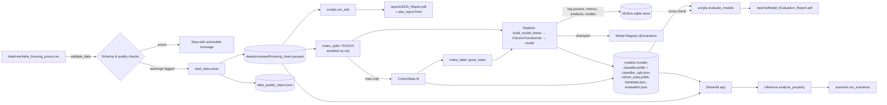

# Architecture & Data Flow

## Overview

## Layers

| Layer | Module | Responsibility |
|---|---|---|
| Config | `src/utils/config.py` | Every path, constant and assumption (rates, cohort keys, thresholds, sources). Paths can be overridden by environment variables. |
| Data | `src/data/validate_data.py` | Errors (unusable data) vs warnings (inconsistent records). Returns a `ValidationReport`. |
| | `src/data/load_data.py` | Load, clean (₹/sqft recomputed, amenities parsed, flags added), fingerprint, write parquet. |
| Features | `src/features/engineering.py` | `build_model_frame()` is the **single** transform used by training and inference. `CohortStats` holds training-only medians with City → global fallback. |
| Models | `target.py` | The documented good-value rule. |
| | `classification.py` | Splits, candidate models, the two feature tracks, raw-input pipelines, grouped permutation importance. |
| | `regression.py` | Valuation signal test (price from attributes; price never enters as input). |
| | `scenario.py` | Compounding scenarios with validated rates. |
| | `inference.py` | `load_bundle`, `validate_property` (blocking errors + out-of-distribution warnings), `analyze_property`. |
| Evaluation | `src/evaluation/metrics.py` | Classification/regression metrics, ECE, ROC/calibration curves. |
| Viz | `src/visualization/charts.py` | Plotly template and charts shared by the EDA report and the app. Aggregates before plotting. |
| UI | `src/ui/` | Design tokens and CSS, escaped HTML components, cached loaders, session helpers. |
| App | `app.py`, `views/*.py` | Navigation and six pages. Pages never train models. |

## Key design decisions

1. **Feature engineering lives inside the saved pipeline** (`FunctionTransformer(build_model_frame)`), so
   the artefact accepts raw-schema rows and replays exactly the training transforms. A test confirms that the
   batch path and the single-record path give identical probabilities.
2. **Leakage control.** Cohort medians are fitted on the training split only. The median itself is never a
   model input. Test data never influences selection.
3. **Honest targets.** No synthetic future-price labels are created. Five-year values come from scenarios.
4. **MLflow is optional at runtime.** Training logs to a local SQLite store and registers the champion
   (`@champion` alias). The app reads the small `models/` bundle, whose run IDs link back to MLflow, so it
   deploys without an MLflow server. `scripts/evaluate_models.py` cross-checks bundle metrics against MLflow.
5. **Portable model files.** The XGBoost champion is saved with XGBoost's own `save_model` JSON format
   (`models/classifier_xgb.json`) next to a joblib file holding only the scikit-learn steps
   (`src/models/persistence.py`). A pickled booster written on Linux failed to load on Windows
   ("input stream corrupted") even with identical library versions; the JSON format is XGBoost's
   supported cross-platform format.
6. **Safe model logging.** Models are logged with MLflow's `skops` format, an explicit trusted-types list and
   `code_paths=["src"]` so the logged model is self-contained.
7. **Theming through config first.** `.streamlit/config.toml` sets colours, fonts, radii, borders and the
   sidebar. Custom CSS targets only our own `pw-*` classes plus two stable `data-testid` hooks.
8. **Charts never ship raw rows.** Distributions are pre-binned, boxes use precomputed quantiles, and the
   scatter is sampled, so pages stay fast on 250k rows.

## Runtime behaviour

- `st.cache_data` caches the parquet; `st.cache_resource` caches the model bundle.
- Missing data or models produce an actionable error and stop the page instead of crashing.
- Session state holds recent analyses (max 10) and the comparison list (max 4). Nothing is persisted
  server-side, and the dashboard labels these as session-only.
